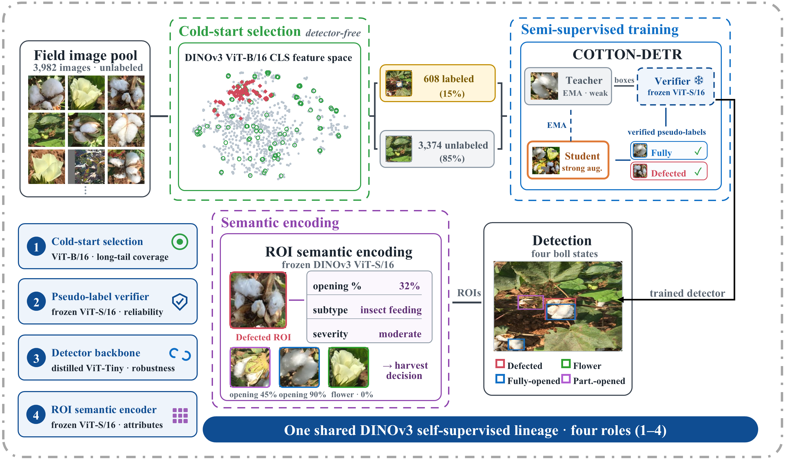
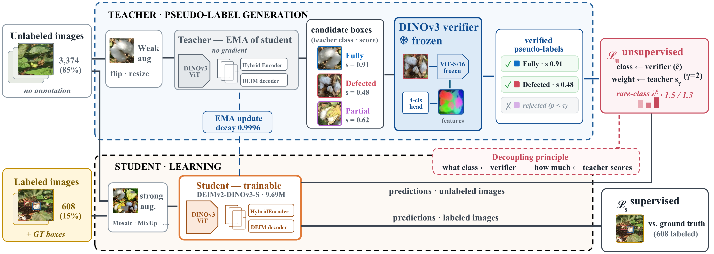
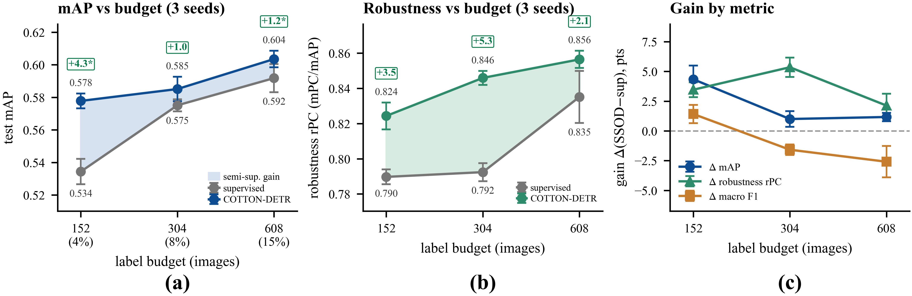
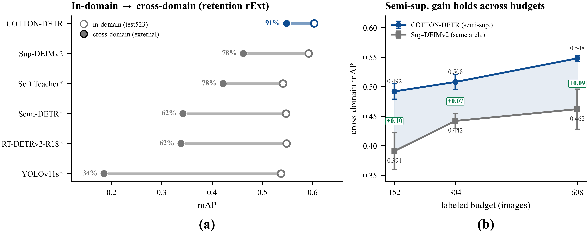
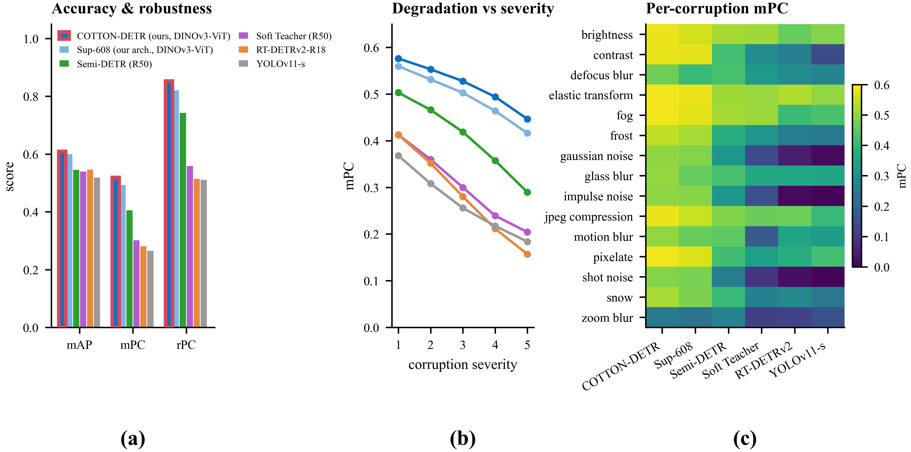
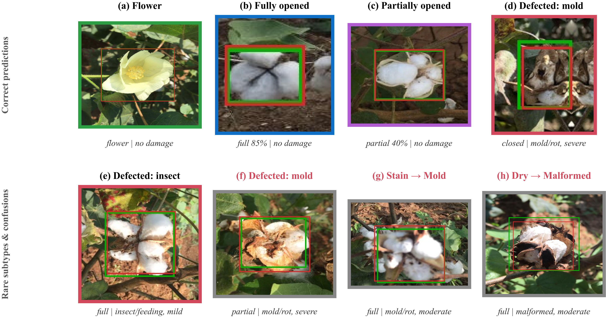

<div align="center">

# COTTON-DETR

### Label-efficient in-field cotton boll-state detection

**Detector-free cold-start selection and reliability-controlled semi-supervised learning driven by a shared DINOv3 lineage**

[English](README.md) | [中文](README.zh-CN.md) | [Reproducibility](REPRODUCIBILITY.md) | [License](LICENSE)

[](LICENSE)

</div>

<p align="center">
  
</p>

## Overview

Precise annotation of field imagery is expensive, while agronomic targets are often dense, fine-grained, and strongly long-tailed. COTTON-DETR is a label-efficient detection pipeline that reuses one DINOv3 self-supervised model lineage across four roles: detector-free image selection, pseudo-label verification, a distilled DETR backbone, and post-detection ROI semantic encoding.

With 608 labeled images (15% of a 3,982-image field pool), COTTON-DETR reaches **0.604 mAP** and **0.856 rPC** on the in-domain test set. Its main semi-supervised benefit appears under distribution shift: relative to the same-architecture supervised model, unlabeled data improves cross-domain mAP by **+0.086** while retaining **91%** of in-domain accuracy. The release is intentionally scoped to code, sanitized configurations, prompts, and reproducibility utilities; private data, weights, checkpoints, and experiment archives are not included.

## Highlights

- **Detector-free cold start.** Frozen DINOv3 ViT-B/16 features select a distribution-covering annotation head before any task detector exists, then expand coverage toward the rare defective class.
- **Reliability-controlled SSOD.** An independent frozen DINOv3 verifier reclassifies and filters teacher boxes. Pseudo-label class identity is determined by the verifier, while confidence weighting remains tied to teacher evidence.
- **Label efficiency with bounded claims.** Three-seed experiments show the largest in-domain mAP gain at 152 labels (+0.043); gains narrow at larger budgets, while corruption robustness remains positive at all budgets.
- **Cross-domain generalization.** At 608 labels, COTTON-DETR improves combined external-domain mAP from 0.462 to 0.548 over the same-architecture supervised baseline.
- **Semantic output beyond boxes.** A frozen DINOv3 ROI encoder predicts opening state and percentage, damage subtype, and severity as structured agronomic cues.

## Method

<p align="center">
  
</p>

COTTON-DETR follows a teacher-student DETR design. The EMA teacher proposes candidate boxes from weakly augmented unlabeled images. A frozen DINOv3 ViT-S/16 verifier independently checks ROI class identity and rejects unreliable candidates. The student is optimized with verified pseudo-labels on strongly augmented unlabeled images and ground-truth boxes on labeled images.

The method separates two decisions that detector-only self-training usually couples:

1. **What class is this ROI?** The DINOv3 verifier supplies the class decision.
2. **How much should it contribute?** The teacher score supplies the loss weight.

This decoupling targets confirmation bias in rare classes without treating the verifier as a second trainable detector.

## Results

### Label efficiency and corruption robustness

<p align="center">
  
</p>

The controlled comparison uses the same DEIMv2-DINOv3-S architecture, labeled subsets, augmentations, and evaluation split. The semi-supervised rows additionally use 3,374 unlabeled images. Values are three-seed mean ± standard deviation on the 523-image test set.

`mPC` is mean mAP over corruption types and severities; `rPC` is `mPC / clean mAP`.

| Method | Labels | mAP ↑ | mPC / rPC ↑ |
|---|---:|---:|---:|
| Supervised | 152 | 0.534 ± 0.008 | 0.422 ± 0.006 / 0.790 ± 0.004 |
| **COTTON-DETR** | **152** | **0.578 ± 0.005** | **0.476 ± 0.008 / 0.824 ± 0.008** |
| Supervised | 304 | 0.575 ± 0.004 | 0.456 ± 0.005 / 0.792 ± 0.005 |
| **COTTON-DETR** | **304** | **0.585 ± 0.007** | **0.495 ± 0.005 / 0.846 ± 0.004** |
| Supervised | 608 | 0.592 ± 0.009 | 0.494 ± 0.004 / 0.835 ± 0.015 |
| **COTTON-DETR** | **608** | **0.604 ± 0.005** | **0.517 ± 0.003 / 0.856 ± 0.005** |

Using the reported best-test checkpoints for the matched-budget generic SSOD comparison, COTTON-DETR reaches 0.578/0.604 mAP at 152/608 labels, compared with 0.496/0.541 for Soft Teacher and 0.497/0.547 for Semi-DETR. These checkpoint-level comparisons show that direct transfer of generic SSOD recipes is not sufficient for this long-tailed field setting.

### Component evidence

| Component | Three-seed evidence at 608 labels | Interpretation |
|---|---|---|
| DINOv3 verifier | Defective F1: 0.561 ± 0.043 → **0.606 ± 0.013** | Repairs and stabilizes the rare class; mAP changes only from 0.599 to 0.604. |
| DINOv3 cold-start selection | Defective F1: 0.591 ± 0.055 → **0.618 ± 0.005** | Primarily improves rare-class coverage and variance rather than mean mAP. |
| Unlabeled training data | rPC gains of +0.035, +0.053, and +0.021 at 152/304/608 labels | Adds a smaller but consistent robustness gain within the same architecture. |

### Generalization to unseen domains

<p align="center">
  
</p>

On two unseen field domains, COTTON-DETR achieves **0.548 ± 0.005 mAP** and **0.908 ± 0.016 rExt**, compared with **0.462 ± 0.034 mAP** and **0.780 ± 0.061 rExt** for the same-architecture supervised baseline, where `rExt = external mAP / in-domain mAP`. The +0.086 cross-domain mAP gain is about seven times its +0.012 in-domain gain at the 608-label budget. The external evaluation is limited to 180 images and 510 boxes; broader cross-location and cross-crop validation remains open.

### Corruption robustness

<p align="center">
  
</p>

The cross-architecture trend is primarily associated with the DINOv3-distilled detector backbone. Within the same architecture, semi-supervised learning contributes a smaller positive increment. Synthetic ImageNet-C-style corruptions are used as a controlled proxy for imaging degradation and should not be interpreted as a substitute for real domain shift.

### ROI semantic encoding

<p align="center">
  
</p>

The optional semantic component converts detected ROIs into opening state, opening percentage, damage subtype, and severity. Prototype matching raises damage-severity consistency F1 from 0.448 to **0.611** when measured against ROI-level VLM labels. These outputs are structured visual cues, not expert pathology diagnoses or human-verified ground truth.

## Repository Structure

```text
COTTON-DETR/
├── configs/cotton_detr/       # Public SSOD and semantic templates
├── engine/                    # Detector, criterion, solver, and SSOD runtime
├── selection/                 # Cold-start selection algorithms
├── semantic/                  # ROI semantic encoding library
├── tools/selection/           # Feature extraction and selection CLIs
├── tools/verifier/            # Verifier training and calibration
├── tools/evaluation/          # Corruption metric utilities
├── tools/semantic/            # Semantic training, validation, and export
├── prompts/                   # Open ROI semantic-labeling prompts
├── scripts/                   # Reproducibility preflight checks
├── REPRODUCIBILITY.md         # End-to-end rerun protocol
└── third_party/licenses/      # Upstream license notices
```

## Installation

Training is supported on Linux with an NVIDIA GPU. Install the PyTorch build that matches your CUDA driver before the remaining dependencies.

```bash
git clone https://github.com/hwzhanng/COTTON-DETR.git
cd COTTON-DETR

python -m venv .venv
source .venv/bin/activate

# Example only; select the wheel matching your CUDA environment.
pip install torch==2.5.1 torchvision==0.20.1 --index-url https://download.pytorch.org/whl/cu121
pip install -r requirements-repro.txt
```

## Data and Weights

The default configuration expects COCO-format annotations:

```text
data/
├── candidate/images/
├── labeled/images/
├── unlabeled/images/
├── val/images/
└── annotations/
    ├── candidate_train.json
    ├── coverage_head_labeled.json
    ├── labeled_train.json
    ├── unlabeled_train.json
    ├── val.json
    └── test.json
```

Users must obtain the DEIMv2-DINOv3 detector initialization and DINOv3 model files under their upstream terms, and train verifier heads from their own labeled data. Run the preflight checker before training:

```bash
python scripts/check_repro_package.py \
  --config configs/cotton_detr/cotton_detr_dinov3_tiny_ssod.yml
```

Use `--allow-missing` only while preparing the directory structure.

## Reproducing the Pipeline

### 1. Cold-start selection

```bash
python tools/selection/extract_dinov3_features.py \
  --image-dir data/candidate/images \
  --model-dir weights/pretrained/dinov3_vits16 \
  --output-dir outputs/selection/features

python tools/selection/select_cold_start.py \
  --method cluster_head \
  --features outputs/selection/features/dinov3_features.npy \
  --paths outputs/selection/features/dinov3_paths.npy \
  --candidate-coco data/annotations/candidate_train.json \
  --exclude-coco data/annotations/val.json \
  --exclude-coco data/annotations/test.json \
  --budget 500 \
  --output-dir outputs/selection/coverage_head
```

After annotating the coverage head, run the `cluster_tail` stage and derive nested 152/304/608 subsets. Exact commands and leakage checks are documented in [REPRODUCIBILITY.md](REPRODUCIBILITY.md#cold-start-selection).

### 2. Verifier calibration

```bash
python tools/verifier/train_linear_verifier.py \
  --train-coco data/annotations/labeled_train.json \
  --train-image-dir data/labeled/images \
  --val-coco data/annotations/val.json \
  --val-image-dir data/val/images \
  --model-dir weights/pretrained/dinov3_vits16 \
  --target-precision 0.85 \
  --output-dir outputs/verifier
```

### 3. Semi-supervised training

```bash
bash train_guarded.sh \
  -c configs/cotton_detr/cotton_detr_dinov3_tiny_ssod.yml \
  -t weights/pretrained/deimv2_dinov3_s_coco_tuning.pth \
  -d cuda \
  --seed 0 \
  --use-amp
```

### 4. Teacher-EMA evaluation

```bash
python tools/evaluate_ssod_teacher.py \
  -c configs/cotton_detr/cotton_detr_dinov3_tiny_ssod.yml \
  --checkpoint outputs/cotton_detr_ssod/best_teacher_ema.pth \
  --output-dir outputs/cotton_detr_ssod/eval \
  -d cuda
```

### 5. Optional semantic sidecar

```bash
python tools/semantic/validate_semantic_labels.py \
  data/semantic/semantic_labels_train.jsonl \
  --fail-on-error

python tools/semantic/train_semantic_head.py \
  --config configs/cotton_detr/semantic_sidecar_template.yaml
```

Open prompt templates and the JSONL schema are provided in [tools/semantic](tools/semantic/). The full seed plan, weight layout, evaluation protocol, and reporting checklist are in [REPRODUCIBILITY.md](REPRODUCIBILITY.md).

## Release Scope

This repository includes the executable method path, sanitized configs, prompt templates, and paper figures. It does **not** redistribute:

- private cotton datasets or annotations;
- pretrained model files or verifier heads;
- checkpoints, logs, feature caches, or raw experiment outputs;
- private manuscript drafts, review material, or VLM responses.

Generated selections, semantic labels, and evaluation artifacts are ignored by Git and should remain outside public commits.

## Citation

Academic use of this repository requires citation of our article. The article link and complete citation metadata will be added after publication.

- Article: [COTTON-DETR]()

## License and Third-Party Notices

Original COTTON-DETR additions and release materials are licensed under [CC BY-NC 4.0](LICENSE). Non-commercial use is permitted with attribution; commercial use requires prior written permission from the COTTON-DETR authors.

Third-party components retain their upstream licenses. DEIM, D-FINE, and RT-DETR materials are distributed under Apache-2.0 terms; DINOv3 code and model materials are governed by the Meta DINOv3 License. See [NOTICE.md](NOTICE.md), [OPEN_SOURCE_AUDIT.md](OPEN_SOURCE_AUDIT.md), and [third_party/licenses](third_party/licenses/) for the exact boundaries.

## Acknowledgements

COTTON-DETR builds on DEIM/DEIMv2, D-FINE, RT-DETR, and DINOv3. We thank the authors of these projects for making their research code and model ecosystems available.
