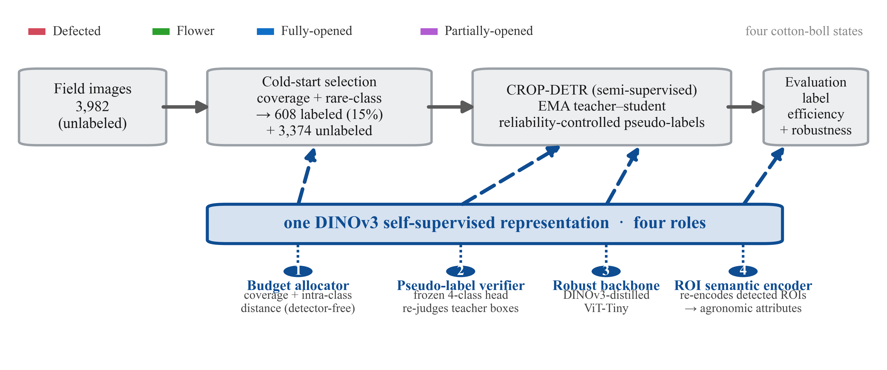
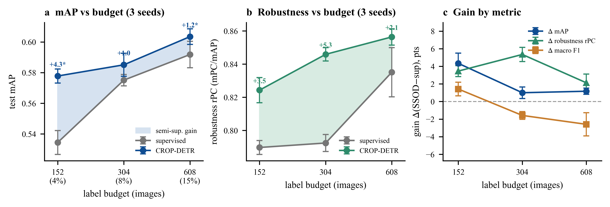
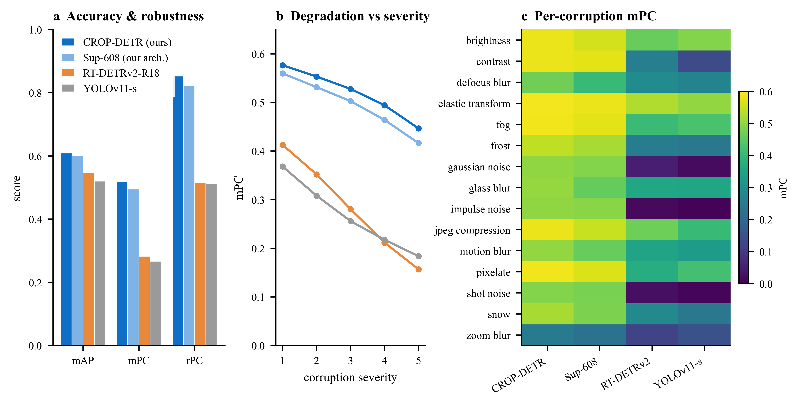
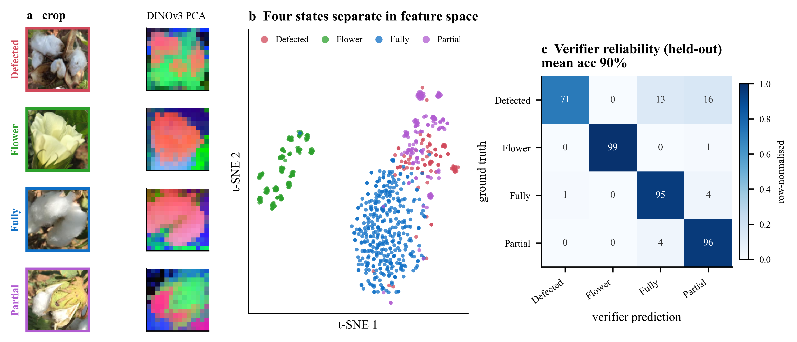
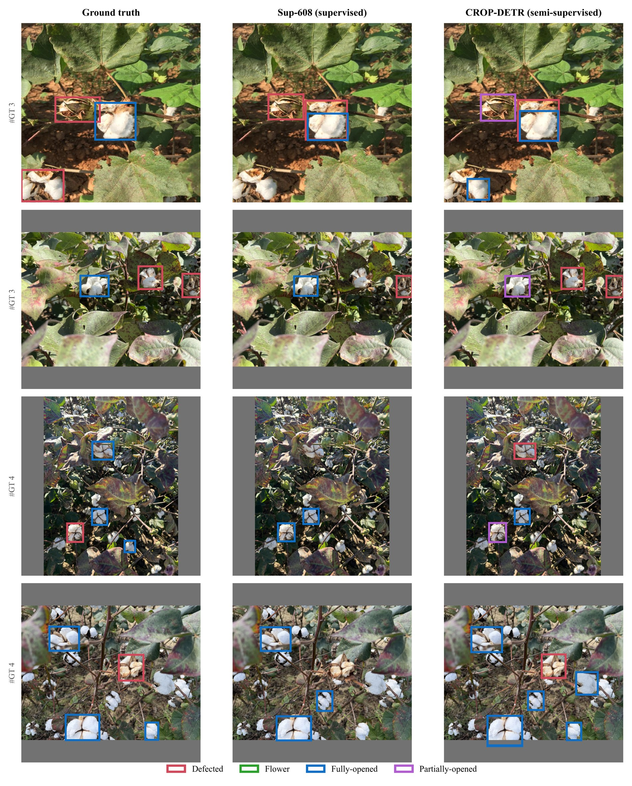
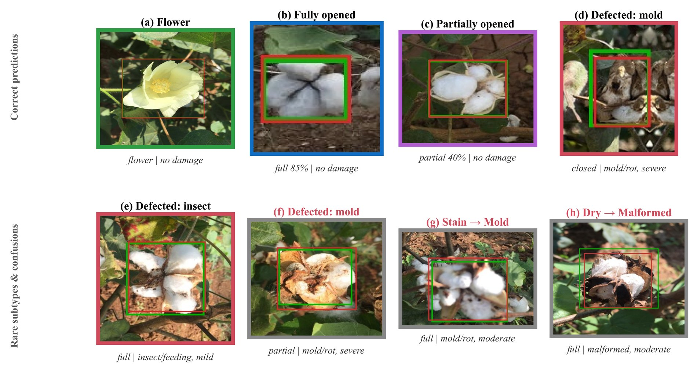

# COTTON-DETR

**面向低标注、长尾棉铃多状态检测的检测器无关冷启动选样与
DINOv3 验证半监督 DETR。**

[English](README.md) | [中文](README.zh-CN.md)

<p align="center">
  
</p>

COTTON-DETR 是一套标注高效的田间棉铃检测代码。论文的核心结论不在
单个组件，而在一个可复用设计：同一族 DINOv3 自监督表征可以在长尾
农业检测流程中协同承担四个角色。

1. **冷启动选样**：在训练任何检测器之前决定标注哪些图像。
2. **伪标签验证**：用冻结 DINOv3 验证器过滤教师预测，而不是只信检测器分数。
3. **DINOv3 蒸馏检测骨干**：提供紧凑且腐蚀鲁棒的 DETR 检测器。
4. **检测后语义编码**：把检测框扩展为结构化农艺属性。

本仓库包含代码、脱敏配置、复现实验说明和 README 用的论文图。仓库不包含
数据集、预训练权重、验证器头、检查点、训练日志、论文草稿或原始实验归档。

## 论文管线

仓库按论文流程的执行顺序组织。

**1. 在训练检测器之前选图。** 先为候选训练池提取冻结 DINOv3 特征，
选择 500 张覆盖性样本进入标注，再利用已标注样本中的稀缺类种子簇扩展到
608 张。

```bash
python tools/selection/extract_dinov3_features.py \
  --image-dir data/candidate/images \
  --model-dir weights/pretrained/dinov3_vits16 \
  --output-dir outputs/selection/features

python tools/selection/select_cold_start.py \
  --method cluster_head \
  --features outputs/selection/features/dinov3_features.npy \
  --paths outputs/selection/features/dinov3_paths.npy \
  --candidate-coco data/annotations/candidate_train.json \
  --exclude-coco data/annotations/val.json \
  --exclude-coco data/annotations/test.json \
  --budget 500 \
  --head-budget 500 \
  --n-clusters 50 \
  --per-cluster 10

python tools/selection/select_cold_start.py \
  --method cluster_tail \
  --features outputs/selection/features/dinov3_features.npy \
  --paths outputs/selection/features/dinov3_paths.npy \
  --candidate-coco data/annotations/candidate_train.json \
  --exclude-coco data/annotations/val.json \
  --exclude-coco data/annotations/test.json \
  --output-coco-from data/annotations/train_pool_with_boxes.json \
  --seed-coco data/annotations/coverage_head_labeled.json \
  --budget 608 \
  --head-budget 500 \
  --n-clusters 50 \
  --per-cluster 10 \
  --target-class-id 0 \
  --target-box-count 90
```

同一入口也提供 `random` 和 `kcenter` 基线。`cluster_head` 不需要标签；
`cluster_tail` 只使用已经选入覆盖头部的标注。完整参数和防泄漏检查见
[tools/selection](tools/selection/)。

**2. 用标注图和无标注图训练 COTTON-DETR。** 将选出的标注写入
`data/annotations/labeled_train.json`，将剩余训练池保留为
`unlabeled_train.json`，然后使用公开 SSOD 模板训练。

**3. 评估 teacher EMA checkpoint。** 使用
`tools/evaluate_ssod_teacher.py` 按论文口径评估 teacher 分支。

**4. 检测后补充语义属性。** 可选语义 sidecar 使用 ROI crop 和开源提示词
生成的标签，为检测框附加开裂、损伤等结构化属性。

## 论文结论

| 问题 | 论文发现 |
|---|---|
| 半监督最主要帮在哪里？ | mAP 增益集中在最低标注预算：**152 张标注图像处 +0.043 mAP**，配对检验显著；304/608 张标注图像处收敛到约 +0.01。 |
| 鲁棒性增益是否稳定？ | 稳定。mPC/rPC 在每个预算下均提升；608 张标注图像时 COTTON-DETR 为 **0.517 mPC / 0.856 rPC**，纯监督为 **0.494 / 0.835**。 |
| 通用 SSOD 方法能否直接迁移？ | 在该长尾场景下不可靠。608 张标注图像时 Soft Teacher 和 Semi-DETR 为 **0.541/0.547 mAP**，低于纯监督锚点 **0.592**；COTTON-DETR 为 **0.604**。 |
| 稀缺残次铃类由什么改善？ | 两端共同贡献：DINOv3 冷启动选样把残次 F1 稳定到 **0.618±0.005**（随机为 **0.591±0.055**）；验证器相对仅检测器分数带来 **+0.092 残次 F1**。 |
| 检测框能否输出更多农艺语义？ | 语义编码组件在论文的 VLM 标签一致性口径下，把损伤严重程度 F1 从 **0.448** 提升到 **0.611**。 |

## 主结果

<p align="center">
  
</p>

在增强对齐的公平对照下，纯监督锚点与 COTTON-DETR 的唯一差异是
COTTON-DETR 使用 3,374 张无标注图。下表均为 523 张测试图像上的
3 种子均值 ± 标准差。

| 方法 | 标注图像 | mAP ↑ | AP50 ↑ | mPC / rPC ↑ | 残次 F1 ↑ | 宏观 F1 ↑ |
|---|---:|---:|---:|---:|---:|---:|
| 纯监督 | 152 | 0.534±0.008 | 0.748±0.009 | 0.422±0.006 / 0.790±0.004 | 0.574±0.027 | 0.738±0.010 |
| COTTON-DETR | 152 | **0.578±0.005** | **0.789±0.006** | **0.476±0.008 / 0.824±0.008** | **0.600±0.035** | **0.752±0.009** |
| Δ | 152 | **+0.043** | +0.041 | +0.054 / +0.035 | +0.026 | +0.014 |
| 纯监督 | 304 | 0.575±0.004 | **0.795±0.003** | 0.456±0.005 / 0.792±0.005 | **0.626±0.015** | **0.775±0.010** |
| COTTON-DETR | 304 | **0.585±0.007** | 0.791±0.007 | **0.495±0.005 / 0.846±0.004** | 0.611±0.013 | 0.759±0.006 |
| Δ | 304 | +0.010 | -0.004 | +0.039 / +0.053 | -0.015 | -0.016 |
| 纯监督 | 608 | 0.592±0.009 | 0.804±0.013 | 0.494±0.004 / 0.835±0.015 | **0.618±0.005** | **0.792±0.010** |
| COTTON-DETR | 608 | **0.604±0.005** | **0.812±0.003** | **0.517±0.003 / 0.856±0.005** | 0.606±0.013 | 0.766±0.004 |
| Δ | 608 | **+0.012** | +0.009 | +0.023 / +0.021 | -0.012 | -0.026 |

这个结论是有边界的：无标注数据主要提升 mAP 和鲁棒性；类别层面的长尾
改善主要来自冷启动选样与验证器门控。

## 鲁棒性

<p align="center">
  
</p>

大的鲁棒性差距主要来自骨干。608 张标注图像设置下，DINOv3 架构检测器在
ImageNet-C 风格腐蚀下保留约 85% 的 clean 性能，而 CNN 基线约为 51%。
在同一 DINOv3 架构内部，半监督贡献较小但稳定：各预算 rPC 额外提升
约 +0.02 到 +0.05。

## 验证器为什么有效

<p align="center">
  
</p>

验证器之所以轻量，是因为冻结 DINOv3 特征空间已经能较好地区分四类棉铃
状态。消融中，仅检测器分数筛选伪标签时 mAP、残次 F1、宏观 F1 分别为
0.592、0.530、0.764；加入 DINOv3 验证器后提升到 0.605、0.622、0.790。

## 定性结果

<p align="center">
  
</p>

在含稀缺类的难图上，COTTON-DETR 召回了纯监督锚点容易漏掉的残次铃和
部分开裂铃。该图对应主结果中的 608 张标注图像高预算设置。

## 语义编码

<p align="center">
  
</p>

在四类检测之外，COTTON-DETR 复用冻结 DINOv3 ROI 特征预测开裂状态、开裂
比例、损伤亚型和损伤严重程度。该模块应被理解为结构化农艺线索，而不是
替代专家病理诊断。

用于生成兼容 ROI 级语义标签的提示词已开源为
[中文](prompts/semantic_roi_labeling_zh.md) 和
[英文](prompts/semantic_roi_labeling_en.md) 两个模板。

语义编码模块的训练和导出入口位于 `tools/semantic/`：

```bash
python tools/semantic/train_semantic_head.py \
  --config configs/cotton_detr/semantic_sidecar_template.yaml

python tools/semantic/export_semantics.py \
  --config configs/cotton_detr/semantic_sidecar_template.yaml \
  --detections outputs/cotton_detr_ssod/test_detections.json \
  --coco-images data/annotations/test.json \
  --image-dir data/test/images \
  --output outputs/cotton_detr_ssod/test_detections_with_semantics.json
```

## 仓库结构

```text
configs/cotton_detr/                       脱敏后的公开 SSOD 模板
engine/                                  模型、损失、求解器、验证器与 SSOD 代码
selection/                               可复用冷启动选样算法
tools/selection/                         DINOv3 特征提取与选样命令行工具
tools/verifier/                          DINOv3 验证器头训练与阈值标定
tools/evaluation/                        腐蚀鲁棒性 mPC/rPC 汇总工具
semantic/                                语义编码模块库
tools/semantic/                          语义编码训练/导出工具
tools/evaluate_ssod_teacher.py           teacher EMA 评估入口
scripts/check_repro_package.py           数据/权重/config 预检脚本
docs/assets/                             README 使用的 web 版论文图
prompts/                                 ROI 语义标注开源提示词
REPRODUCIBILITY.md                       复现实验协议与报告清单
third_party/licenses/                    上游许可证副本
```

## 你需要自行提供

- COCO 格式标注训练集。
- COCO 格式无标注图像记录；无标注记录可以没有 boxes。
- COCO 格式验证集标注。
- 用于冷启动选样的候选训练图像池。
- 稀缺类尾部扩展所需的覆盖头部标注，可选。
- 符合上游许可证的 DEIM/DINOv3 骨干权重。
- 冻结 DINOv3 验证器权重：
  - `weights/pretrained/dinov3_vits16/`
  - `weights/pretrained/verifier_head.pt`
  - `weights/pretrained/verifier_head_4cls.pt`

公开模板给出论文 608 图设置中的验证器阈值和类别损失权重。迁移到你的数据集时，需要调整
`num_classes`、`accept_threshold`、`class_loss_scale` 和
`class_balanced_sampling`。

## 快速开始

```bash
pip install -r requirements.txt
python scripts/check_repro_package.py \
  --config configs/cotton_detr/cotton_detr_dinov3_tiny_ssod.yml

bash train_guarded.sh \
  -c configs/cotton_detr/cotton_detr_dinov3_tiny_ssod.yml \
  -t weights/pretrained/deimv2_dinov3_s_coco_tuning.pth \
  -d cuda \
  --seed 0 \
  --use-amp
```

评估训练后的 SSOD checkpoint：

```bash
python tools/evaluate_ssod_teacher.py \
  -c configs/cotton_detr/cotton_detr_dinov3_tiny_ssod.yml \
  --checkpoint outputs/cotton_detr_ssod/best_teacher_ema.pth \
  --output-dir outputs/cotton_detr_ssod/eval \
  -d cuda
```

严格环境、种子计划、数据布局和结果归档清单见
[REPRODUCIBILITY.md](REPRODUCIBILITY.md)。

## 许可证与声明

我们自己的 COTTON-DETR 新增部分按 [LICENSE](LICENSE) 中的 Apache License
2.0 发布。第三方派生部分保留上游许可证：DEIM、D-FINE、RT-DETR 为
Apache-2.0；DINOv3 代码和模型材料遵循 Meta DINOv3 License。许可证副本
位于 [third_party/licenses/](third_party/licenses/)。

本仓库不重新分发数据集、预训练权重、验证器头、检查点或原始实验输出。
用户需要自行确保外部模型权重和数据集的使用符合对应许可证。

## 引用

论文标题和引用信息尚未最终定稿。公开发布前在此处补充正式引用。
